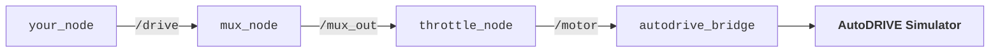

# AutoDRIVE-NeoRacer


NeoRacer digital twin with careful `real2sim` calibration and API parity for zero-shot `sim2real` experimentation.

The implementation emulates the hardware I/O of NeoRacer (ESP32-S3, LakiBeam1, USB-Camera) with the same QoS; the `mux_node` and `throttle_node` from the `neoracer_ros2_driver` package run unmodified alongside it (along with the `gamepad_node` and `inference_node`). This way, the digital twin exercises the same chain of command as the physical twin of the vehicle:

Existing dashboards, code, packages, demos, labs, etc. for [`neoracer_ros2_driver`](https://github.com/Neobotics-Foundation-Inc/neoracer_ros2_driver) (Neobotic's NeoRacer), [`osracer`](https://github.com/osrbot/osracer) (OSRBOT's OSRacer), or [`racecar-neo-library`](https://github.com/Neobotics-Foundation-Inc/racecar-neo-library) (MIT's RACECAR Neo) work unchanged (and vice versa).

> [!NOTE]
> - Speed:
>   - `/motor` speed matches `neoracer_ros2_driver` with a range of ±6 m/s.
>   - The ESP32-S3 on the physical twin closes the speed control loop, while this node uses feedforward + feedback (PID) control on measured speed to reproduce the physical twin's closed-loop behavior.
>   - `/drive` expects `speed` command for the vehicle to be normalized [-1.0, 1.0]. The actuation limits of the vehicle `speed` are ±6 m/s (safety cap). Positive command corresponds to forward vehicle motion, while negative command corresponds to reverse vehicle motion.
> - Steering:
>   - Firmware maps ±30° steering across the full servo pulse swing.
>   - The steering linkage reaches ±30° wheel lock at only 0.625 of the full servo pulse swing. This makes the wire-to-wheel gain 1/0.625 = 1.6.
>   - `/motor` steer is capped at 0.625 so the servo cannot drive past the mechanical steering linkage limit.
>   - A 0.625 ms (625 us) servo pulse swing is the maximum pulse-width deviation from center used to command full travel in either direction.
>   - Steering command = 1.0 <==> `/motor` = 0.625 <==> wheels at 30° lock
>   - `/drive` expects `steering_angle` command for the vehicle to be normalized [-1.0, 1.0]. The actuation limits of the vehicle `steering_angle` are ±0.5236 rad (30°). Positive command corresponds to left-hand turn, while negative command corresponds to right-hand turn.
>   - `racecar-neo-library`'s convention is inverted with positive steering command corresponding to a right-hand turn. This inversion is handled by [`drive_real.py`](https://github.com/Neobotics-Foundation-Inc/racecar-neo-library/blob/main/library/real/drive_real.py#L55C9-L55C23).
> - Odometry:
>   - `/odom` intentionally publishes `twist.angular` zero, matching `neoracer_ros2_driver`'s documented behavior.
>   - Consumers should obtain yaw rate from `/imu`, preserving the same interface contract as the physical twin.
> - Camera:
>   - `/camera` contains JPEG bytes in `sensor_msgs/Image` with encoding `jpeg`, matching `neoracer_ros2_driver`'s convention.
>   - RGB image with 640x480 pixel resolution.
> - LIDAR:
>   - `/scan` contains a full circle (360°) range measurements spanning -180° to 180° at 0.25° resolution, represented as a 1440-bin array of float32 distances in meters matching `neoracer_ros2_driver`.
>   - For `/scan` topic, `ranges` index 0 points straight behind the vehicle, and the subsequent elements progress counter-clockwise. Only the 270° window (|angle| <= 135°) carries returns; no-return = inf. The rear sector (between 135° and 225°) is blind; returns inf.
>   - `racecar-neo-library`'s scan is represented as a 1440-bin array of float32 distances in centimeters, index 0 points straight ahead of the vehicle, and the subsequent elements progress clockwise; no-return = 0.0 & rear blind sector (between 135° and 225°) returns 0.0.

## Requirements

- The setup has been developed and tested on [Ubuntu 22.04](https://ubuntu.com) with [ROS 2 Humble](https://docs.ros.org/en/humble/index.html).
> [!NOTE]
> Ubuntu 22.04 + ROS 2 Humble is a deliberate choice since the same distro runs on the physical vehicle, so all the tooling and codebase works unmodified across the digital and physical twins.
- A [containerized version](https://hub.docker.com/r/autodriveecosystem/autodrive_neoracer_api) of the setup has been released and tested to work on [Ubuntu 22.04](https://ubuntu.com), as well as [Windows (WSL 2 + Ubuntu 22.04)](https://learn.microsoft.com/en-us/windows/wsl) and [macOS](https://www.apple.com/os/macos), with [known limitations](docker_limitations.md).
> [!NOTE]
> The containerized workflow assumes that:
> - [Docker](https://docs.docker.com/engine/install) is installed.
> - If the container is to take advantage of an NVIDIA GPU, the host machine has been properly configured by installing the necessary NVIDIA GPU drivers and the [NVIDIA Container Toolkit](https://docs.nvidia.com/datacenter/cloud-native/container-toolkit/latest/index.html).

## Installation

A single shell script, [`autodrive_install.sh`](autodrive_install.sh), installs and configures the development environment on Ubuntu 22.04 substrate. It invokes the service setup delegated to [`autodrive_services.sh`](autodrive_services.sh).
```
cd </path/to/autodrive_neoracer>
sudo bash autodrive_install.sh
```
The script uses `SUDO_USER` to put workspaces and shell settings under the invoking user's home. Most command failures stop the script; optional clones or update failures are reported and skipped.
> [!NOTE]
> - If `apt` reports stale index or package download errors such as `404`, run `sudo apt update` and rerun the installer script.
> - If a command fails, `set -e` generally stops the script at that point. Correct the underlying issue and rerun it; many steps are repeatable, but move any needed files elsewhere before rerunning if you have customized `~/jupyter_ws/neoracer-os/{library, labs}`, since the script replaces these directories.
> - After installation, open a new terminal or run `source ~/.bashrc` to load the ROS overlays, DDS profile, and aliases.

### ROS 2 and System Setup

- Configures `UTF-8 locale`, installs `software-properties-common` and enables `universe` repository.
- Queries GitHub for the latest `ros-apt-source` release, installs it with `dpkg`, updates `apt` indexes, and upgrades installed `apt` packages.
- Installs `ros-humble-desktop` (ROS 2 Humble Desktop) and `ros-dev-tools`.
- Installs additional ROS 2 packages including `diagnostic-updater`, `tf-transformations`, `joint-state-publisher`, `imu-tools`, `imu-complementary-filter`, `vision-msgs`, `cv-bridge`, `image-transport-plugins`, `libg2o`, `slam-toolbox`, `robot-localization`, `navigation2`, `nav2-bringup`, `ackermann-msgs`, and `rosbag2-storage-mcap`.

### Python Dependencies

- Invokes system `pip3` to install the `Python 3` dependencies for `autodrive_bridge`, including `eventlet`, `Flask`, `Flask-SocketIO`, `python-socketio`, `python-engineio`, `greenlet`, `gevent`, `gevent-websocket`, `Jinja2`, `itsdangerous`, `werkzeug`, `attrdict`, `numpy`, `pillow`, `opencv-contrib-python`, and `transforms3d`.
- Installs `luma.led_matrix`, `jupyterlab`, `ultralytics`, `pandas`, and `scipy` required by `neoracer_ros2_driver`, `neoracer-os/{library,labs}`, and other core functions.

### Workspaces and Shell Tool

- Creates a Jetson-style `/jetson_thermal/` tree with fixed thermal-zone emulations for compatibility; these values are not live sensor readings.
- Copies `fastdds_udp.xml` to `~/fastdds_udp.xml` as the default DDS profile to use UDPv4 and disable Fast DDS built-in transports.
- Populates `~/jupyter_ws/neoracer-os/{library,labs}` from the `racecar-neo-library` and `neoracer-labs` repositories. The library directory is added to the user's Python import path through `racecar_student.pth` in user site-packages. Existing `library` and `labs` contents are replaced.
- Creates `~/ros2_ws`, links `autodrive_neoracer` to `ros2_ws/src/autodrive_neoracer`, clones or reuses `~/neoracer_ros2_driver` and links it to `ros2_ws/src/neoracer_ros2_driver`, then builds the workspace with `colcon`.
- Creates `~/osracer_ws`, clones the osracer `product/neo` branch with submodules if it is not already present, and builds the workspace with `colcon`.
- Adds ROS overlay sourcing, the Fast DDS profile, and the `autodrive-bringup`, `autodrive-autonomy`, and `autodrive-start` aliases to `~/.bashrc` if the `AutoDRIVE-NeoRacer` marker is not already present. Also sources the `racecar-tool.sh` when available.

### Lab Dashboards

- Clones or fast-forward-updates lab dashboard repositories under `~/neoracer_ros2_driver/scripts/dashboards`.
- Configured to pull `camlabel`, `wallfollow`, `pursuit`, `eps`, `smartfollow`, `linefollow`, `webteleop`.
- Failed clones and non-fast-forwardable checkouts are skipped without aborting installation.

### System Services

- Creates `Supervisor` configuration directories, `/run/neoracer-supervisor` with a `teleop` lock file, and initializes the `enabled` list to `teleop`, `watchdog`, `dashboard`, and `jupyter` (with an empty disabled list).
- Writes `/etc/supervisor/conf.d/neoracer.conf` and service definitions for `teleop`, `autonomy`, `dashboard`, `jupyter`, and `watchdog`. Services are configured with `autostart=false`; the startup helper later starts those listed as enabled. It also adds definitions for lab dashboards only when their Python entry-point files exist.
- Installs `/usr/local/sbin/neoracer-supervisor-start`, which starts `supervisord`, waits up to five seconds for its socket, and attempts to start each enabled service.
- If the driver's `racecar-tool.sh` exists, copies this service script to `~/autodrive_services.sh` and rewrites the driver's service setup and `systemctl`/`journalctl` calls to use the AutoDRIVE configuration and wrappers.
- Installs limited `/usr/local/bin/systemctl` and `/usr/local/bin/journalctl` compatibility wrappers backed by `supervisorctl` and service log files.
> [!NOTE]
> - Installer script, `autodrive_install.sh`, invokes `autodrive_services.sh` companion script as root to set up system services.
> - The `systemctl` wrapper supports only a subset of operations; it is not a full `systemd` replacement, enabling compatibility with host setup as well as containers.
> - The installer does not itself launch the underlying vehicle stack, startup occurs when the host or container invokes the installed `neoracer-supervisor-start`.

## Bringup

Setup auto-executes following system services (with same unit names as on the physical vehicle) required for bringup with the host boot-up or container spin-up:
- `neoracer-teleop`: AutoDRIVE Devkit ROS 2 API for NeoRacer
- `neoracer-watchdog`: AutoDRIVE-NeoRacer watchdog process monitor
- `neoracer-dashboard`: Interactive system dashboard (http://localhost:8080)
- `neoracer-jupyter`: Interactive JupyterLab session (http://localhost:8888)

Use the `racecar service` interface to work with the service units:
```
racecar service status          # Get status of all services
racecar service start <name>    # Start a service by name
racecar service stop <name>     # Stop a service by name
racecar service restart <name>  # Restart a service by name
racecar service restart         # Restart all services
racecar service logs <name>     # Inspect a service log
```
> [!NOTE]
> The `watchdog` monitors the `autodrive_bridge`, `gamepad_node`, `mux_node`, `throttle_node`, `inference_node`, and the topic contract listed below. It waits for AutoDRIVE data after the connection on port `4567` before checking data-dependent health. If the `teleop` service stops or a required runtime node is missing, it stops `teleop`, releases TCP port `4567`, and restarts `teleop` only after the port is confirmed closed. If the port cannot be released, recovery is aborted and the failure is written to `~/logs/latest/watchdog.log`, which appears in the system dashboard's watchdog log. Critical topics are also checked, but their absence is reported only as warnings. Loss of AutoDRIVE data itself is reported as well, but does not trigger a restart.

The bringup spins-up required ROS 2 nodes resulting in topic contract following the physical vehicle convention:

| Topic                | Type                                       |
|----------------------|--------------------------------------------|
| `/battery`           | `sensor_msgs/msg/BatteryState`             |
| `/battery/voltage`   | `std_msgs/msg/Float32`                     |
| `/camera/color`      | `sensor_msgs/msg/Image`                    |
| `/dotmatrix/text`    | `std_msgs/msg/String`                      |
| `/drive`             | `ackermann_msgs/msg/AckermannDriveStamped` |
| `/edgetpu/inference` | `vision_msgs/msg/Detection2DArray`         | 
| `/encoder/speed`     | `std_msgs/msg/Float32`                     |
| `/gamepad_drive`     | `ackermann_msgs/msg/AckermannDriveStamped` |
| `/imu/fused`         | `sensor_msgs/msg/Imu`                      |
| `/joy`               | `sensor_msgs/msg/Joy`                      |
| `/mag`               | `sensor_msgs/msg/MagneticField`            |
| `/motor`             | `ackermann_msgs/msg/AckermannDriveStamped` |
| `/mux_out`           | `ackermann_msgs/msg/AckermannDriveStamped` |
| `/odom`              | `nav_msgs/msg/Odometry`                    |
| `/rc/channels`       | `std_msgs/msg/Float32MultiArray`           |
| `/scan`              | `sensor_msgs/msg/LaserScan`                |
> [!NOTE]
> The `/edgetpu/inference` topic will not be published by default since the `inference_node` is disabled.

The automated bringup enables convenient latching to user-implemented ROS 2 nodes or Python code:
  - Run ROS 2 node `<your_ros2_node>` compatible with `neoracer_ros2_driver`:
    ```
    ros2 run <your_ros2_package> <your_ros2_node>
    ```
> [!NOTE]
> The `autodrive_neoracer` package ships with `teleop_keyboard` node executable:
> ```
> ros2 run autodrive_neoracer teleop_keyboard
> ```
  - Run Python (lab) code `<your_python_code>.py` compatible with `racecar-neo-library` library:
    ```
    python3 ~/jupyter_ws/neoracer-os/labs/<your_python_code>.py
    ```
> [!NOTE]
> The `autodrive_bridge` emulates START automatically. Every lab in `~/jupyter_ws/neoracer-os/labs/` or custom code developed (via JupyterLab) using the `racecar_core` module of the `racecar-neo-library` runs identically on the digital and physical twins of the vehicle.
  - Run lab dashboard compatible with `neoracer_ros2_driver`:
    ```
    racecar service start <dashboard_name>
    ```
    | Lab Dashboard | Run Directly | Start Service | URL |
    |---|---|---|---|
    | `wallfollow` | `python3 ~/neoracer_ros2_driver/scripts/dashboards/wallfollow_dashboard/wallfollow.py` | `racecar service start wallfollow` | http://localhost:8081 |
    | `camlabel` | `python3 ~/neoracer_ros2_driver/scripts/dashboards/camlabel_dashboard/camlabel.py` | `racecar service start camlabel` | http://localhost:8082 |
    | `pursuit` | `python3 ~/neoracer_ros2_driver/scripts/dashboards/pursuit_dashboard/pursuit.py` | `racecar service start pursuit` | http://localhost:8083 |
    | `eps` | `python3 ~/neoracer_ros2_driver/scripts/dashboards/eps_dashboard/eps.py` | `racecar service start eps` | http://localhost:8084 |
    | `smartfollow` | `python3 ~/neoracer_ros2_driver/scripts/dashboards/smartfollow_dashboard/smartfollow.py` | `racecar service start smartfollow` | http://localhost:8085 |
    | `linefollow` | `python3 ~/neoracer_ros2_driver/scripts/dashboards/linefollow_dashboard/linefollow.py` | `racecar service start linefollow` | http://localhost:8086 |
    | `webteleop` | `python3 ~/neoracer_ros2_driver/scripts/dashboards/teleop_dashboard/teleop.py` | `racecar service start webteleop` | http://localhost:8087 |

## Autonomy

The `teleop` service launches the `autodrive_bridge`, `gamepad_node`, `mux_node`, and `throttle_node` (`inference_node` is disabled by default). This exposes the drive-by-wire (DBW) and steer-by-wire (SBW) interface via `/drive` topic, and emulates sensor bringups by routing data to relevant topics noted above. This level of exposure is sufficient for teleoperating the vehicle or deploying perception-enhanced control algorithms (a.k.a. reactive autonomy).

For advanced autonomy development/deployment, the `autonomy.launch.py` can be invoked. This additionally launches `tf2` publishing transforms on `/tf`, `complementary_filter_node` publishing filtered IMU measurements on `/imu_filter`, `ekf_node` publishing EKF-based senser-fusion (IMU + encoders) estimates of vehicle odometry on `/odometry/filtered`, and `twist_bridge` subscribing to `/cmd_vel` (`geometry_msgs/msg/Twist`) and publishing equivalent `ackermann_msgs/msg/AckermannDriveStamped` on `/drive`:
```
ros2 launch autodrive_neoracer autonomy.launch.py
```

Optionally, `slam` and `nav` launch arguments can be used to launch the `autonomy` functions along with pre-configured `slam_toolbox` and `nav2` components respectively:
```
ros2 launch autodrive_neoracer autonomy.launch.py slam:=true
ros2 launch autodrive_neoracer autonomy.launch.py nav:=true
```
> [!NOTE]
> Instead of the long `ros2 launch` commands, use aliases instead:
> ```
> autodrive-autonomy              # autonomy.launch.py
> autodrive-autonomy slam:=true   # autonomy.launch.py slam:=true
> autodrive-autonomy nav:=true    # autonomy.launch.py nav:=true
> ```

Alternatively, with the base `aunonomy` stack running (via `autodrive-autonomy` or `autonomy.launch.py`), `racecar` shell tool can be used to initiate `slam` or `nav` functions:
```
racecar mapping <slam_method>     # SLAM (args: slam_toolbox, gmapping, cartographer)
racecar mapping save <map_name>   # Save the map (arg: custom map name)
```
> [!NOTE]
> Maps save to `~/osracer_ws/src/osracer/osracer_slam/maps`. For loading newly saved maps with `nav2`, rebuild and source `osracer_slam`:
> ```
> cd ~/osracer_ws
> colcon build --packages-select osracer_slam
> source install/setup.bash
> ```
Initiate map-based autonomous navigation with `nav2` on the custom map:
```
racecar navigation <map_name>     # Nav2 (arg: custom map name)
```

## Container

The entire stack has been containerized for dependency isolation and cross-platform compatability. The container image has been released on Docker Hub public registry at [`autodriveecosystem/autodrive_neoracer_api`](https://hub.docker.com/r/autodriveecosystem/autodrive_neoracer_api).

### Pull AutoDRIVE Devkit Container:

```bash
docker pull autodriveecosystem/autodrive_neoracer_api:<TAG>
```

### Run AutoDRIVE Devkit Container:

1. Enable display forwarding:
    ```bash
    xhost local:root
    ```
2. Run the container at `entrypoint`:
    ```bash
    docker run --name autodrive_neoracer_api --rm -it --network=host --ipc=host -v /tmp/.X11-unix:/tmp/.X11-unix:rw --env DISPLAY --privileged --gpus all autodriveecosystem/autodrive_neoracer_api:<TAG>
    ```
3. Start additional bash session(s) within the container (each in a new terminal window):
    ```bash
    docker exec -it autodrive_neoracer_api bash
    ```

## Course


**AuE-4930/6930: Autonomous Vehicles: Racing Application** is a mixed undergraduate/graduate-level course at Clemson University, which introduces the principles, strategies and implementation of AI/ML-enhanced vehicle autonomy (perception, localization, planning and control) deployments within an autonomous racing context. Real-world challenges/constraints from the racing context are used to motivate the systematic application of fundamental knowledge; modular hierarchical decomposition; comparative evaluation and down-selection at the component, subsystem, and system-levels; and scaffolded homeworks, sub-projects, and end-to-end capstone project realization with contemporaneous technologies.

For this course, students will develop their autonomous racing algorithms using the **AutoDRIVE Devkit** (ROS 2), safely prototype them within the **AutoDRIVE Simulator** (digital twin), and deploy them onto the **AutoDRIVE Testbed** (physical twin). Here, [NeoRacer](https://neobotics.org/kits) serves as the reference vehicle platform for [AutoDRIVE](https://autodrive-ecosystem.github.io), with the corresponding high-fidelity, real2sim-calibrated digital twin represented in AutoDRIVE Simulator and the physical twin integrated into AutoDRIVE Testbed, which enables sim2real transfer and fielded deployment in the real world. AutoDRIVE Devkit provides a common [ROS 2](https://www.ros.org) interface across the digital and physical twins, allowing students to develop and validate their autonomous racing algorithms in simulation and subsequently deploy them on the physical NeoRacer with consistent vehicle behavior and interfaces. Together, these components provide a unified development-to-deployment workflow spanning software, simulation, and hardware.

> [!TIP]
> - The tech stack for this course has been released publicly on [GitHub](https://github.com/AutoDRIVE-Ecosystem/Clemson-University-AuE-X930-Tech-Stack).
> - The lab resources for this course have been released publicly on [GitHub](https://github.com/Tinker-Twins/AuE-X930-Autonomous-Racing).

## Citation

We encourage you to read and cite the following papers if you use any part of the framework for your research:

#### [AutoDRIVE: A Comprehensive, Flexible and Integrated Digital Twin Ecosystem for Enhancing Autonomous Driving Research and Education](https://arxiv.org/abs/2212.05241)
```bibtex
@article{AutoDRIVE-Ecosystem-2023,
author = {Samak, Tanmay and Samak, Chinmay and Kandhasamy, Sivanathan and Krovi, Venkat and Xie, Ming},
title = {AutoDRIVE: A Comprehensive, Flexible and Integrated Digital Twin Ecosystem for Autonomous Driving Research & Education},
journal = {Robotics},
volume = {12},
year = {2023},
number = {3},
article-number = {77},
url = {https://www.mdpi.com/2218-6581/12/3/77},
issn = {2218-6581},
doi = {10.3390/robotics12030077}
}
```
This work has been published in **MDPI Robotics.** The open-access publication can be found on [MDPI](https://doi.org/10.3390/robotics12030077).

#### [AutoDRIVE Simulator: A Simulator for Scaled Autonomous Vehicle Research and Education](https://arxiv.org/abs/2103.10030)
```bibtex
@inproceedings{AutoDRIVE-Simulator-2021,
author = {Samak, Tanmay Vilas and Samak, Chinmay Vilas and Xie, Ming},
title = {AutoDRIVE Simulator: A Simulator for Scaled Autonomous Vehicle Research and Education},
year = {2021},
isbn = {9781450390453},
publisher = {Association for Computing Machinery},
address = {New York, NY, USA},
url = {https://doi.org/10.1145/3483845.3483846},
doi = {10.1145/3483845.3483846},
booktitle = {2021 2nd International Conference on Control, Robotics and Intelligent System},
pages = {1–5},
numpages = {5},
location = {Qingdao, China},
series = {CCRIS'21}
}
```
This work has been published at **2021 International Conference on Control, Robotics and Intelligent System (CCRIS).** The publication can be found on [ACM Digital Library](https://dl.acm.org/doi/abs/10.1145/3483845.3483846).
